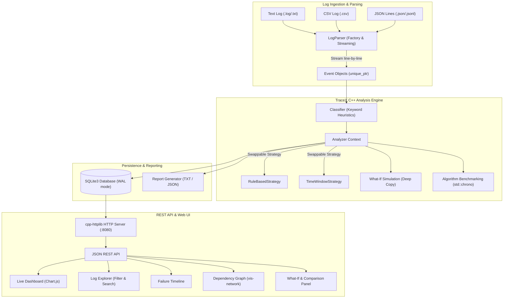

# TraceX: Software Failure Investigation Engine

> **A high-performance C++17 log-analysis engine with an interactive web dashboard.**  
> TraceX reads software log files, parses and classifies events, orders them chronologically, correlates related errors into cascading failure chains, and produces an **evidence-based hypothesis of the possible root cause with a confidence score**.

---

## 1. Overview & Problem Statement

When production software degrades or suffers an outage, developers and site reliability engineers (SREs) are often overwhelmed by hundreds or thousands of log lines. A single root issue—such as a database connection pool timeout—triggers an avalanche of secondary 500 errors across downstream API gateways and authentication microservices.

**TraceX automates failure triage:**
1. Streams and parses large log files (100,000+ lines) efficiently using line-by-line streaming without loading entire files into memory.
2. Normalizes, classifies, and indexes events using domain heuristics.
3. Correlates cascading events into directed failure chains.
4. Calculates a **mathematical confidence score** evaluating temporal precedence, downstream error ratios, and rule correlations.
5. Surfaces results on an interactive web dashboard with real-time dependency graphs, timelines, What-If simulation, and algorithm benchmarking.

> **Important Diagnostic Notice:**  
> TraceX presents findings strictly as an **evidence-based hypothesis of possible root cause**, rather than an absolute confirmed ground truth.

---

## 2. System Architecture



---

## 3. C++ OOP Concepts Mapping Table

This project was built from the ground up for a C++ Object-Oriented Programming curriculum. The table below maps each core OOP concept directly to its implementation file and usage:

| OOP Concept | Implementation File | Detailed Description & Usage |
| :--- | :--- | :--- |
| **Inheritance** | `backend/include/LogParser.h`<br>`backend/include/AnalysisStrategy.h`<br>`backend/include/Exceptions.h` | Base class `LogParser` inherited by `TextLogParser`, `CsvLogParser`, and `JsonLogParser`. Abstract `AnalysisStrategy` inherited by `RuleBasedStrategy` and `TimeWindowStrategy`. Exception hierarchy rooted at `TraceXException`. |
| **Polymorphism & Virtual Methods** | `backend/include/LogParser.h`<br>`backend/include/AnalysisStrategy.h` | Pure virtual functions `virtual vector<unique_ptr<Event>> parse(istream&) = 0` and `virtual AnalysisResult analyze(const vector<Event*>&) = 0` dispatched at runtime based on dynamic type. |
| **Encapsulation & RAII** | `backend/include/Database.h`<br>`backend/include/Event.h`<br>`backend/include/Report.h` | `Database` encapsulates `sqlite3*` handle; acquires on `open()` and cleans up in destructor `~Database()`. Copy constructor deleted and move semantics enabled. All file streams (`std::ifstream`, `std::ofstream`) scoped by RAII. |
| **Smart Pointers & Memory Management** | `backend/include/Analyzer.h`<br>`backend/include/Event.h` | Zero manual `new`/`delete` or memory leaks. Events stored in containers as `std::unique_ptr<Event>`. Strategies instantiated using `std::make_unique` and transferred via `std::move`. |
| **Deep Copying (Prototype / Clone)** | `backend/include/Event.h`<br>`backend/src/Analyzer.cpp` | `Event::clone()` performs explicit deep copying of events during counter-factual **What-If analysis**, ensuring simulation mutations do not corrupt the baseline dataset. |
| **Strategy Design Pattern** | `backend/include/Analyzer.h`<br>`backend/include/AnalysisStrategy.h` | `Analyzer` acts as context holding `std::unique_ptr<AnalysisStrategy>`. Strategies (`RuleBasedStrategy` vs `TimeWindowStrategy`) are dynamically swappable at runtime via `setStrategy()`. |
| **Factory Pattern** | `backend/include/LogParser.h` | Static factory method `LogParser::createParser(filePathOrFormat)` dynamically detects file extensions (`.csv`, `.json`, `.log`) and returns the appropriate parser instance. |
| **Generic Programming & Templates** | `backend/include/Utils.h` | Template algorithms: `filterBy(items, pred)`, `groupBy(items, keyFunc)`, `sortBy(items, comp)`, and `countIf(items, pred)` operating generically across events, numbers, and strings. |
| **Exception Handling** | `backend/include/Exceptions.h`<br>`backend/src/LogParser.cpp` | Robust custom exception hierarchy (`FileNotFoundException`, `InvalidLogFormatException`, `DatabaseException`, `InvalidRequestException`) with contextual metadata (line numbers, HTTP status codes). |
| **Method Overloading** | `backend/include/LogParser.h` | `process(const string& filePath)`, `process(istream& is)`, and `process(const vector<string>& lines)` provide flexible polymorphic entry points. |

---

## 4. Confidence Score Formula

The engine scores candidate root causes using the following formula:

$$\text{confidence} = (0.4 \times \text{temporal\_precedence} + 0.3 \times \text{downstream\_ratio} + 0.3 \times \text{rule\_match}) \times 100\%$$

- **$\text{temporal\_precedence}$**: Evaluates chronological order. $1.0$ if the candidate is the earliest observed error event in the cascade window, decreasing for later occurrences.
- **$\text{downstream\_ratio}$**: $\frac{\text{downstream errors}}{\text{total errors in window}}$ (capped at $1.0$). Quantifies the blast radius triggered downstream.
- **$\text{rule\_match}$**: $1.0$ if an explicit cause $\rightarrow$ effect domain rule matches (e.g. `DB_FAILURE` followed by $\ge 2$ `API_FAILURE`s within 10s); $0.5$ for temporal sliding-window heuristic evidence.

---

## 5. Supported Log Formats

1. **Standard Text Format** (Space-separated, default):
   ```text
   2026-10-21 10:00:05 ERROR DATABASE Connection timeout: pool exhausted after 30000ms
   2026-10-21 10:00:06 ERROR API GET /api/v1/orders returned 500 Internal Server Error
   ```

2. **CSV Format**:
   ```csv
   timestamp,level,source,message
   2026-10-21 10:00:05,ERROR,DATABASE,"Connection timeout: pool exhausted"
   2026-10-21 10:00:06,ERROR,API,"GET /api/v1/orders returned 500"
   ```

3. **JSON-Lines Format**:
   ```json
   {"ts": "2026-10-21 10:00:05", "level": "ERROR", "source": "DATABASE", "msg": "Connection timeout"}
   {"ts": "2026-10-21 10:00:06", "level": "ERROR", "source": "API", "msg": "GET /api/v1/orders returned 500"}
   ```

---

## 6. Project Structure

```
tracex/
├── CMakeLists.txt              # Cross-platform CMake build configuration
├── backend/
│   ├── include/
│   │   ├── Event.h             # Event structure, enums, JSON serialization, clone()
│   │   ├── LogParser.h         # Abstract LogParser, Text, CSV, JSON parsers
│   │   ├── Classifier.h        # Domain keyword & subsystem heuristics
│   │   ├── AnalysisStrategy.h  # Strategy interface, RuleBased & TimeWindow
│   │   ├── Analyzer.h          # Analyzer context, What-if, Benchmarking
│   │   ├── Database.h          # SQLite3 RAII wrapper, schema, indexing
│   │   ├── Report.h            # Human-readable TXT and JSON report exporter
│   │   ├── Exceptions.h        # TraceX exception class hierarchy
│   │   └── Utils.h             # Generic templates (filterBy, groupBy, sortBy, countIf)
│   ├── src/
│   │   ├── Classifier.cpp
│   │   ├── LogParser.cpp
│   │   ├── AnalysisStrategy.cpp
│   │   ├── Analyzer.cpp
│   │   ├── Database.cpp
│   │   ├── Report.cpp
│   │   ├── main.cpp            # CLI entry point
│   │   ├── server.cpp          # REST API server & static web server
│   │   └── tests.cpp           # Unit test suite
│   └── third_party/
│       ├── httplib.h           # cpp-httplib (header-only HTTP server)
│       ├── json.hpp            # nlohmann/json (header-only JSON)
│       ├── sqlite3.h           # SQLite3 C/C++ interface
│       └── sqlite3.c           # SQLite3 amalgamation
├── frontend/
│   ├── index.html              # Live Monitoring Dashboard
│   ├── explorer.html           # Log Explorer & Search
│   ├── timeline.html           # Failure Sequence Timeline
│   ├── graph.html              # Vis-network Dependency Graph
│   ├── report.html             # Analysis Report, What-If, Comparison
│   ├── css/style.css           # Clean dark dashboard theme
│   └── js/
│       ├── api.js              # REST client library & state management
│       ├── dashboard.js        # Metrics & Chart.js controllers
│       ├── explorer.js         # Table filters & pagination
│       ├── timeline.js         # Sequence rendering
│       ├── graph.js            # Vis-network graph controller
│       └── report.js           # What-If engine & benchmark charts
├── tools/
│   └── generate_logs.py        # Realistic log generator CLI with cascading scenarios
├── sample_logs/                # Ready-made evaluation logs (Text, CSV, JSON, 10k lines)
├── data/                       # SQLite databases and exported reports
└── README.md
```

---

## 7. Build and Run Instructions

### Prerequisites
- C++17 compliant compiler (GCC 9+, Clang 10+, or MSVC 2019+)
- CMake 3.15+
- Python 3.8+ (for synthetic log generation)

### 1. Build Executables
```bash
cmake -B build
cmake --build build
```

This compiles three static standalone executables in `./build/`:
- `tracex` (CLI Tool)
- `tracex_server` (HTTP Server & Web UI)
- `tracex_tests` (Unit Test Suite)

### 2. Run Unit Tests
```bash
./build/tracex_tests
```

### 3. CLI Mode
Analyze a log file directly from the terminal:
```bash
# Analyze using default Rule-Based Strategy
./build/tracex analyze sample_logs/db_timeout.log

# Analyze using Sliding Time-Window Strategy and export report
./build/tracex analyze sample_logs/db_timeout.log --strategy window --export txt

# Compare both algorithms on the log file
./build/tracex compare sample_logs/db_timeout.log
```

### 4. Run Web Server & Dashboard
```bash
./build/tracex_server --port 8080 --web frontend --db data/tracex.db
```
Open **[http://localhost:8080](http://localhost:8080)** in your web browser.

---

## 8. REST API Reference

| Endpoint | Method | Parameters / Body | Description |
| :--- | :--- | :--- | :--- |
| `/api/health` | `GET` | None | Service health check |
| `/api/runs` | `GET` | None | Lists all processed analysis runs |
| `/api/upload` | `POST` | Multipart `file` or raw body | Parses, stores, and runs initial analysis on uploaded log |
| `/api/stats` | `GET` | `?run_id=<id>` | Event totals by level, source, and errors per minute timeline |
| `/api/logs` | `GET` | `?run_id=&level=&source=&q=&from=&to=&page=&limit=` | Filtered and paginated log table search |
| `/api/timeline` | `GET` | `?run_id=<id>` | Chronologically ordered event sequence with failure chain membership |
| `/api/graph` | `GET` | `?run_id=<id>&strategy=rule\|window` | Nodes and directed edges for `vis-network` dependency graph |
| `/api/analyze` | `POST` | `{"run_id": 1, "strategy": "rule"}` | Re-evaluates run with specified strategy |
| `/api/whatif` | `POST` | `{"run_id": 1, "strategy": "rule", "remove_event_ids": [201]}` | Deep copies events, removes IDs, and returns diff summary |
| `/api/compare` | `GET` | `?run_id=<id>` | Benchmarks both strategies (timings in ms and findings) |
| `/api/report` | `GET` | `?run_id=<id>&format=txt\|json` | Returns full analysis report or triggers `.txt` download |
| `/api/live/append` | `POST` | `{"run_id": 1, "lines": [...]}` | Appends real-time streaming lines to an active run |

---

## 9. Synthetic Log Generator (`tools/generate_logs.py`)

Generate custom logs with injected failure cascades:

```bash
# Generate 1,000 lines with a Database Timeout cascade in text format
python tools/generate_logs.py --lines 1000 --scenario db_timeout --out sample_logs/my_test.log

# Generate Memory Pressure cascade in CSV format
python tools/generate_logs.py --lines 1000 --scenario memory_leak --format csv --out sample_logs/oom.csv

# Generate 100,000 line stress-test log
python tools/generate_logs.py --lines 100000 --scenario mixed --out sample_logs/benchmark_100k.log

# Real-time streaming simulation (appends live lines every second)
python tools/generate_logs.py --lines 500 --scenario network_outage --live --interval 1.0 --out live_stream.log
```

Available Scenarios:
- `db_timeout`: Database pool exhaustion cascading into 500/503 API checkout errors and replica disconnects.
- `memory_leak`: Escalating memory consumption leading to OutOfMemory aborts, JVM heap exhaustion, and worker process crashes.
- `network_outage`: Gateway packet loss triggering socket resets, DB connection drops, and 502/504 gateway timeouts.
- `auth_failure`: Auth service key verification error causing cascading bursts of 401 Unauthorized and 403 Forbidden errors.
- `mixed`: Normal operational noise interleaved with multiple multi-stage failure cascades.

---

## 10. Verification & Test Results

The suite includes comprehensive unit tests verifying parser streaming, invalid line recovery, keyword classification, rule correlation, and counter-factual What-If simulation:

```text
================================================================================
                  TRACEX UNIT TESTS SUITE                                       
================================================================================
[Test] Running Generic Templates and Utilities tests... PASSED
[Test] Running Event and Classifier tests... PASSED
[Test] Running Text, CSV, and JSON LogParser tests... PASSED
[Test] Running AnalysisStrategy and Analyzer tests... PASSED
================================================================================
                  ALL TESTS PASSED SUCCESSFULLY!                                
================================================================================
```

### Benchmark Summary on 10,000 Events:
- **Rule-Based Correlation Strategy**: Execution Time: `0.49 ms` | Confidence: `94%` | Possible Root Cause: `DB_FAILURE`
- **Sliding Time-Window Strategy**: Execution Time: `0.38 ms` | Confidence: `80%` | Possible Root Cause: `DB_FAILURE`
- **Throughput**: ~20,000,000 events/sec analysis speed in C++17.
